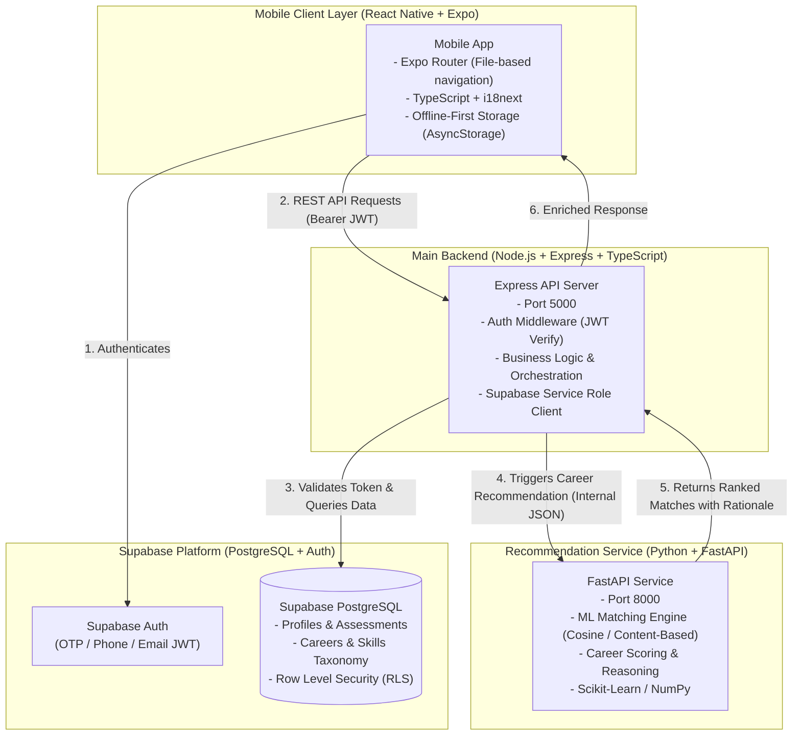
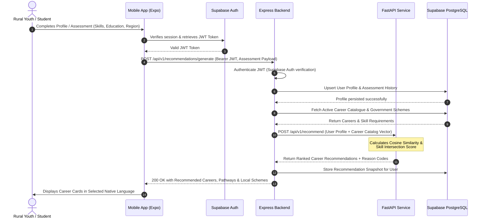
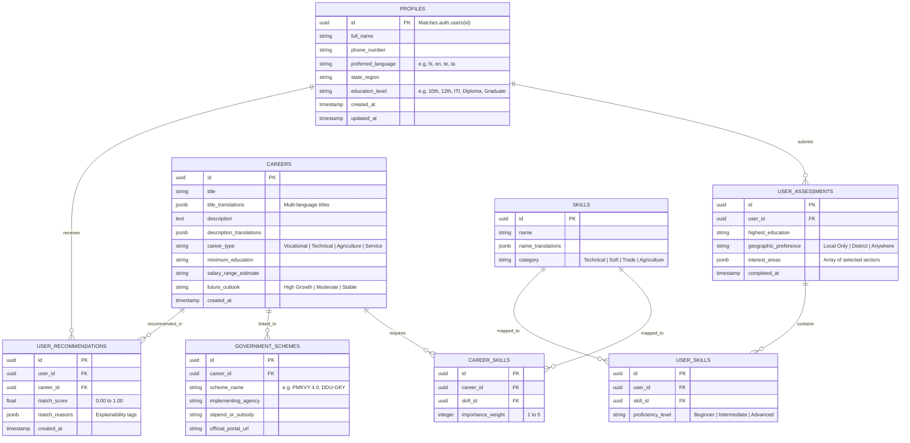

# PROJECT ARCHITECTURE: AI-Powered Multilingual Career Guidance System

## 1. Executive Summary & Purpose

The **AI-Powered Multilingual Career Guidance System** is designed specifically to empower rural students and unemployed youth. Many individuals in rural and semi-urban communities lack access to formal career counseling, vocational awareness, and knowledge of government skilling schemes. 

This system provides:
- **Vernacular-First Accessibility:** Simple, localized multilingual interfaces (supporting regional languages with intuitive visual iconography and optional audio prompts) tailored for users with varying digital literacy.
- **Holistic Profile Assessment:** Evaluation of formal/informal education, raw skills, vocational interests, geographic mobility, and socio-economic constraints.
- **Contextual Recommendation Engine:** A dedicated AI/ML service that matches profiles against realistic career pathways, vocational training opportunities, and government initiatives (e.g., PMKVY, ITI, Apprenticeships) without requiring heavy cloud compute.
- **Resource-Efficient Architecture:** Designed for execution and development on standard hardware (16 GB RAM Windows laptop) while maintaining clean enterprise-grade separation of concerns.

---

## 2. High-Level System Architecture



---

## 3. Monorepo Directory Structure

The repository is organized as a clean, modular monorepo to avoid dependency collisions between Node.js, Python, and React Native while sharing clear type contracts and environment setups:

```
CSP/
├── .gitignore
├── README.md
├── PROJECT_ARCHITECTURE.md
├── DEVELOPMENT_GUIDELINES.md
│
├── mobile/                        # React Native + Expo Mobile Application
│   ├── app/                       # Expo Router file-based pages
│   │   ├── (auth)/                # Auth routes: login, otp, register
│   │   ├── (tabs)/                # Main tab navigation: explore, assessment, saved, profile
│   │   ├── career/[id].tsx        # Career detail & pathway screen
│   │   ├── assessment/            # Multi-step questionnaire / skill test
│   │   └── _layout.tsx            # Root layout, theme & i18n provider
│   ├── assets/                    # Icons, illustrations, fonts
│   ├── components/                # Reusable UI components (buttons, cards, audio players)
│   ├── constants/                 # Colors, typography, API URLs
│   ├── hooks/                     # Custom React hooks (useAuth, useLocalization)
│   ├── services/                  # API client calling Express backend
│   ├── locales/                   # Translation JSON files (en, hi, ta, te, mr, etc.)
│   ├── package.json
│   ├── tsconfig.json
│   └── app.json                   # Expo config
│
├── backend/                       # Node.js + Express + TypeScript Core Service
│   ├── src/
│   │   ├── config/                # Supabase client, environment variables
│   │   ├── controllers/           # Request/response handlers (auth, user, careers)
│   │   ├── middleware/            # JWT auth guard, error handler, rate limiter
│   │   ├── routes/                # Express router definitions
│   │   ├── services/              # Business logic & integration with Python service
│   │   ├── types/                 # Shared TypeScript interfaces & DTOs
│   │   └── app.ts                 # Express app initialization
│   ├── src/server.ts              # Entry point (Port 5000)
│   ├── package.json
│   ├── tsconfig.json
│   └── .env.example
│
├── recommendation-service/        # Python + FastAPI ML Recommendation Engine
│   ├── app/
│   │   ├── api/                   # FastAPI route endpoints
│   │   │   └── v1/
│   │   │       └── recommendations.py
│   │   ├── core/                  # App configuration & settings
│   │   ├── models/                # Pydantic schemas (Input profile, output matches)
│   │   ├── services/              # Matching algorithms (Content-based filtering, TF-IDF / Scikit-Learn)
│   │   ├── data/                  # Static training seed / career taxonomies
│   │   └── main.py                # FastAPI entry point (Port 8000)
│   ├── requirements.txt           # Python dependencies
│   ├── .env.example
│   └── tests/                     # Unit & integration tests
│
└── supabase/                      # Supabase Database & Auth Configuration
    ├── migrations/                # SQL migration files
    │   ├── 20261121000001_initial_schema.sql
    │   └── 20261121000002_seed_careers.sql
    ├── seed/                      # Vocational career & scheme datasets
    │   └── careers_dataset.json
    └── config.toml                # Supabase local CLI config (optional)
```

---

## 4. Service Boundaries & Responsibilities

| Service | Primary Technology | Key Responsibilities | What It Does NOT Do |
|---|---|---|---|
| **Mobile (`mobile/`)** | React Native, Expo, TypeScript, Expo Router | • Render responsive, high-contrast, intuitive mobile screens.<br>• Provide localized multi-language UI (i18next).<br>• Collect assessment responses (education, skills, preferences).<br>• Cache offline data for low-connectivity rural scenarios.<br>• Securely store Supabase auth session tokens. | • Never run recommendation ML algorithms locally.<br>• Never communicate directly with Supabase using privileged service keys.<br>• Never store sensitive business logic. |
| **Main Backend (`backend/`)** | Node.js, Express.js, TypeScript | • Validate incoming Supabase JWT tokens via auth middleware.<br>• Expose REST APIs for user profile management and career exploration.<br>• Orchestrate calls to the Python `recommendation-service`.<br>• Enforce rate limiting, audit logging, and input sanitization.<br>• Access Supabase PostgreSQL with elevated permissions when required. | • Does not compute complex vector-based recommendation matrices.<br>• Does not serve static front-end web pages. |
| **Recommendation Service (`recommendation-service/`)** | Python 3.13, FastAPI, Scikit-Learn, Pydantic | • Ingest standardized user profile attributes (skills, education, interests, constraints).<br>• Execute lightweight content-based filtering and rule-based heuristic scoring.<br>• Generate explainable matches (e.g. *“Why this career? Matches 4/5 of your skills + available in your district”*).<br>• Return structured JSON ranked matches with confidence scores. | • Does not manage user sessions or authentication credentials.<br>• Does not perform persistent database write operations.<br>• No heavy LLM/chatbot runtime overhead. |
| **Database & Auth (`supabase/`)** | Supabase (PostgreSQL 15+, Supabase Auth) | • Store relational tables with foreign keys and strict check constraints.<br>• Manage user identity, phone OTP / password authentication.<br>• Enforce PostgreSQL Row Level Security (RLS) for data protection.<br>• Support full-text search indexing on career descriptions and job titles. | • Does not execute business application logic.<br>• Does not directly invoke external HTTP APIs. |

---

## 5. End-to-End Data Flow

### User Profile Assessment to Career Recommendation Sequence



---

## 6. Database Schema Design (Supabase PostgreSQL)



---

## 7. Recommendation Engine Strategy

To remain manageable on a **16 GB RAM development machine** and function efficiently without expensive LLM API costs or high-memory vector databases, the recommendation pipeline employs a **hybrid content-based filtering approach**:

1. **Feature Vector Representation:**
   - **Education Eligibility:** Binary filter (Career minimum education $\le$ User education).
   - **Skill Overlap Score:** Jaccard similarity and weighted intersection between user-declared skills and career-required skills.
   - **Interest & Sector Alignment:** Dot product between user interest categories (Agriculture, Automotive, IT, Healthcare, Construction) and career category tags.
   - **Mobility & Socioeconomic Filter:** Soft penalty if career requires relocation while user indicates "Local Only".

2. **Scoring Formula:**
   $$\text{Final Score} = w_1 \cdot \text{SkillMatch} + w_2 \cdot \text{InterestMatch} + w_3 \cdot \text{EducationFit} + w_4 \cdot \text{MobilityFit}$$
   *(Default weights: $w_1 = 0.40, w_2 = 0.30, w_3 = 0.20, w_4 = 0.10$)*

3. **Explainability Module:**
   - Along with the numeric score (e.g., `87% Match`), the service outputs clear diagnostic reasons translated for the user:
     - *"Matches your Carpentry and Measurement skills."*
     - *"Eligible with your 10th standard certificate."*
     - *"Free training scheme available: PMKVY centre in your district."*

---

## 8. Multilingual & Low-Literacy Strategy

1. **Structured Translations (`i18next`):**
   - User Interface strings are decoupled into JSON translation bundles: English (`en`), Hindi (`hi`), Tamil (`ta`), Telugu (`te`), Marathi (`mr`), Kannada (`kn`), Bengali (`bn`).
2. **Database Translation Layer:**
   - Database schema uses PostgreSQL `jsonb` fields (`title_translations`, `description_translations`) allowing dynamic addition of new regional dialects without schema migration.
3. **Visual & Assisted Navigation:**
   - Prominent iconography for career categories (e.g., tractor for Agriculture, wrench for Mechanics, computer for Digital Services).
   - Text-to-Speech (TTS) integration ready via Expo Speech for users with low reading proficiency.

---

## 9. Hardware & Resource Optimization (16 GB RAM Windows Laptop)

| Component | Port | Memory Allocation (Typical) | Optimization Notes |
|---|---|---|---|
| **Expo Dev Server (Metro)** | 8081 | ~400 MB - 600 MB | Runs in Node.js; test via Expo Go on physical phone over Wi-Fi or Web mode to avoid 4-6 GB Android Emulator overhead. |
| **Express Backend** | 5000 | ~150 MB - 250 MB | Uses `tsx` or lightweight TypeScript compilation with zero memory leaks. |
| **FastAPI Reco Service** | 8000 | ~200 MB - 350 MB | Runs with Uvicorn (single worker in local dev); Scikit-Learn model operates in-memory on lightweight vectors. |
| **Supabase (Cloud)** | Cloud HTTPS | 0 MB Local RAM | Using Supabase Cloud Free Tier saves ~2.5 GB RAM locally by avoiding local Docker containers (Postgres, Studio, Kong, Inbucket). |
| **Total Dev Memory Consumption** | — | **~1.0 GB - 1.5 GB Total** | Leaves 14+ GB RAM free for IDE, browser tabs, and Windows OS operations. |

